<div align="center">

# Retícula

**Entrenador de puntería 3D en el navegador**

Practica la puntería de cualquier shooter (CS2, Valorant, Apex, Fortnite, Call of Duty, Overwatch),
descubre tu rango y entrena la coordinación ojo-mano. También tiene campaña, modo infinito y modo zombi.


**[Jugar en el navegador](https://ju4nk1807.github.io/Reticula/)** ·
[Descargas (Releases)](https://github.com/Ju4nK1807/Reticula/releases) ·
[Tráiler](#tráiler) ·
[Capturas](#capturas) ·
[Cómo ejecutarlo](#cómo-ejecutarlo)

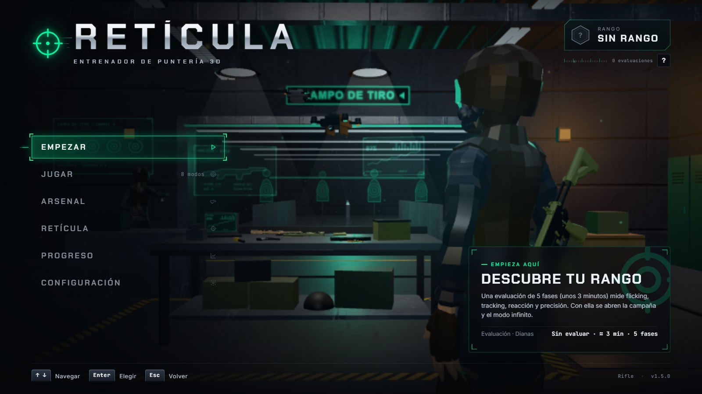

</div>

## Contenido

- [¿Qué es Retícula?](#qué-es-retícula)
- [Tráiler](#tráiler)
- [Capturas](#capturas)
- [Características](#características)
- [Cómo ejecutarlo](#cómo-ejecutarlo)
- [Controles](#controles)
- [Tecnologías y arquitectura](#tecnologías-y-arquitectura)
- [Calidad: pruebas e integración continua](#calidad-pruebas-e-integración-continua)
- [Apps: Windows, Mac y Android](#apps-windows-mac-y-android)
- Modos en detalle: [Evaluación](#evaluación) · [Historia ECO](#historia-eco) · [Campaña](#campaña) ·
  [Coordinación](#coordinación-ojo-mano) · [Infinito](#modo-infinito) · [Zombi](#modo-zombi) ·
  [Defensa de la barra](#defensa-de-la-barra)
- [Mecánicas](#mecánicas) · [Física](#física) · [Rendimiento](#rendimiento) · [Progreso](#progreso) ·
  [Mira y video](#mira-y-video) · [Sensibilidad](#sensibilidad)
- [Estructura del código](#estructura-del-código) · [Publicación](#publicación) · [Equipo](#equipo) ·
  [Créditos](#créditos-de-recursos)

## ¿Qué es Retícula?

Retícula es un **aim trainer** (entrenador de puntería) en 3D, del estilo de KovaaK's o Aim Lab, hecho
desde cero con **Three.js** y JavaScript, sin motor de juego ni frameworks de interfaz. Se juega en el
navegador y también como app de Windows, Mac y Android.

La idea es simple: una **evaluación** de unos 3 minutos mide flicking, tracking, reacción y precisión y
te da un **rango** (Bronce → Élite). Con ese rango se desbloquean la **campaña** y el **modo infinito**,
y todo lo que juegas queda en la pantalla de **Progreso** con gráficas. La sensibilidad se convierte
desde tu juego (CS2, Valorant, etc.), así que lo que entrenas aquí se siente igual allá.

| | |
|---|---|
| **Modos de juego** | 8: dos evaluaciones, historia, campaña, coordinación ojo-mano, infinito, zombi y defensa de la barra |
| **Armas** | 9, con modelo propio, brazos en primera persona, ADS, retroceso, recarga, cuchillo y granadas |
| **Mapas** | Campo de tiro, Patio, Bodega, Ciudad, Arena, Cúpula, Bastión y el Barrio en ruinas (modo zombi) |
| **Código** | ~26 800 líneas de JavaScript en `src/`, 45 archivos de prueba con 425 pruebas automáticas |
| **Plataformas** | Navegador (GitHub Pages), Windows, Mac y Android |

## Tráiler

[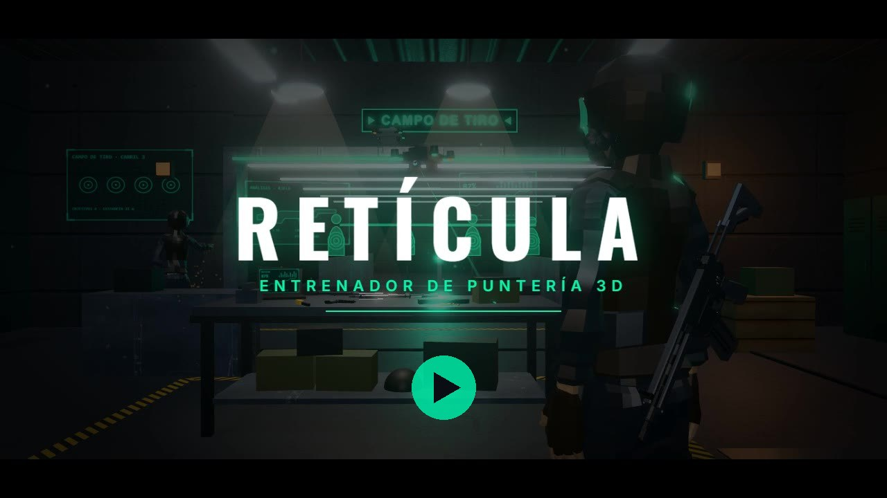](docs/video/reticula-trailer.mp4)

**[Ver el tráiler (48 s)](docs/video/reticula-trailer.mp4)**: las dos evaluaciones (dianas y enemigos), la
campaña, el modo infinito y el modo zombi, grabado del juego real.

## Capturas

### Menú y selección de modo
| Menú principal | Modos de juego |
|---|---|
|  | 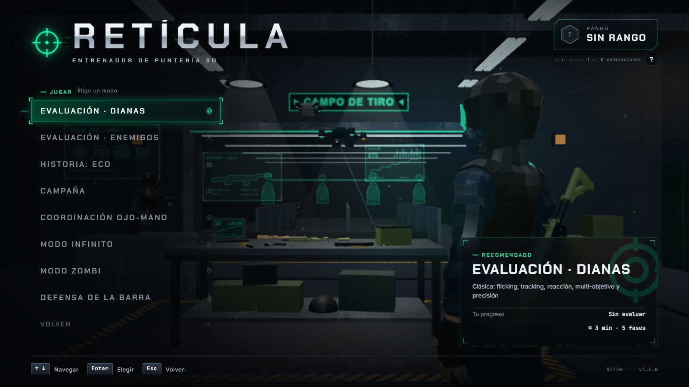 |

### Evaluación (te da tu rango)
| Dianas: flicking en el campo de tiro | Enemigos: bots humanoides en el patio |
|---|---|
| 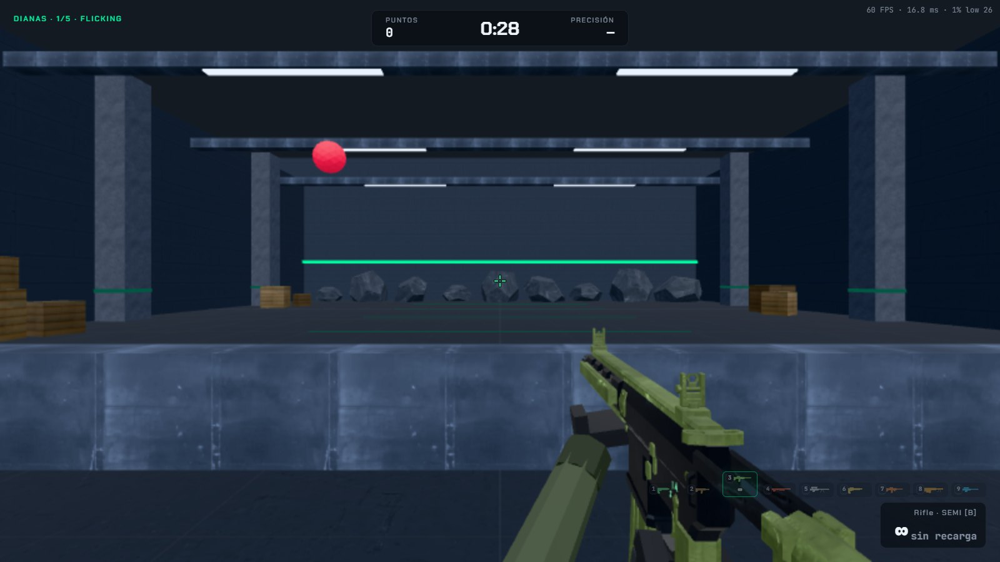 | 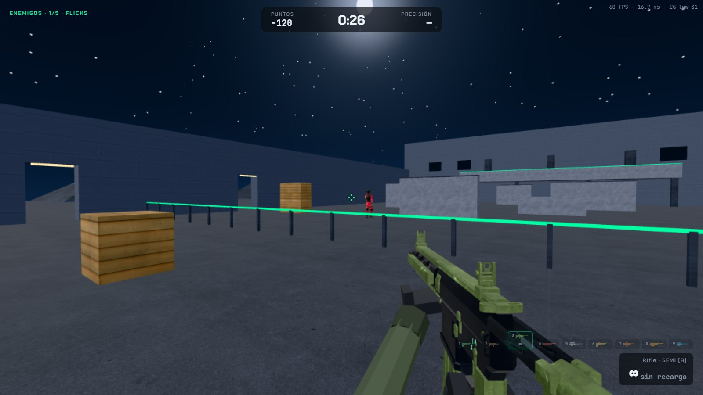 |

### Campaña
| Un mapa por rango | Nivel 1 de la Bodega |
|---|---|
| 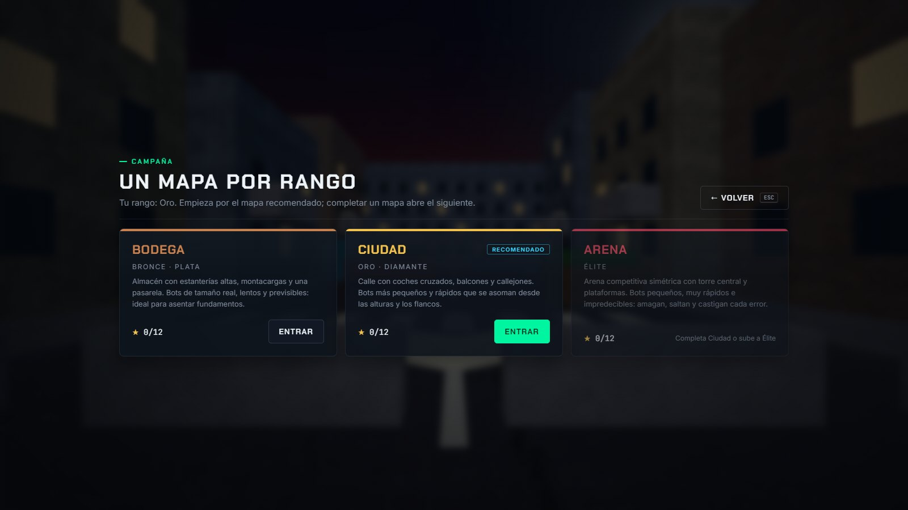 | 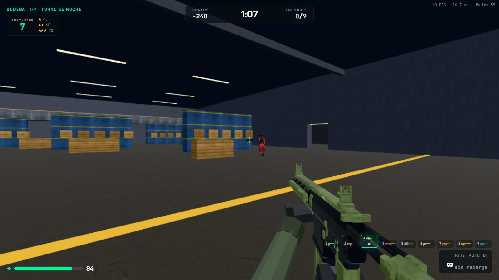 |

### Coordinación ojo-mano
| Ejercicios y circuito | Color objetivo (cada color tiene su forma) |
|---|---|
| 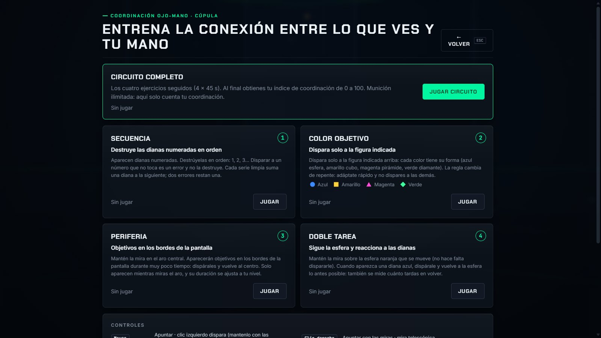 | 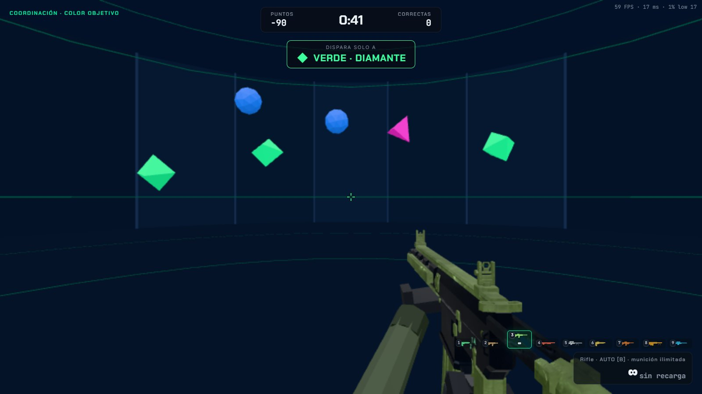 |

### Modo infinito y modo zombi
| Modo infinito en el Bastión | Modo zombi: la horda llega a la barricada |
|---|---|
| 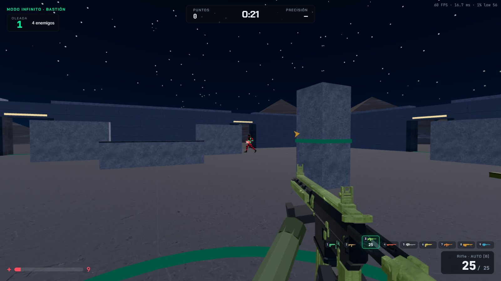 | 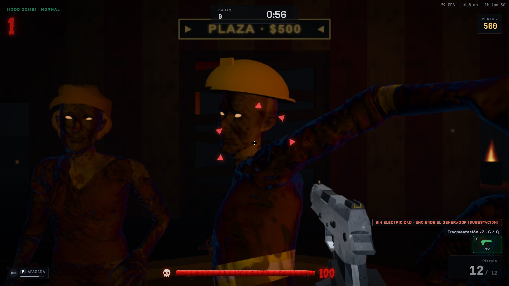 |

| Modo zombi: dificultad y controles | Defensa de la barra (el circo, con la linterna) |
|---|---|
| 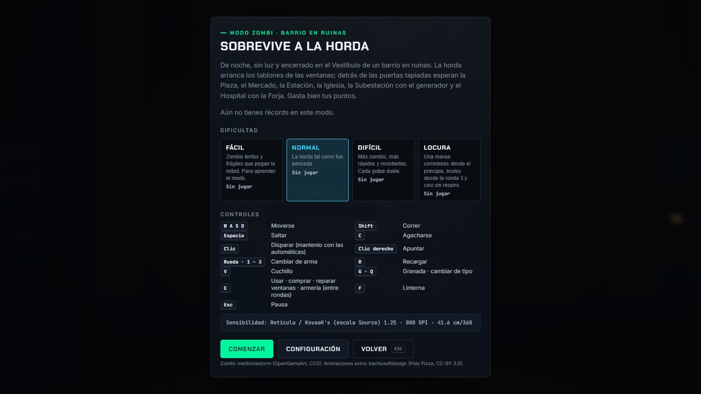 | 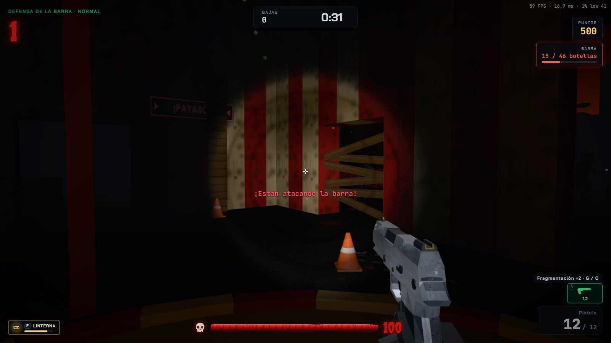 |

### Personalización
| Editor de retícula | Arsenal | Configuración (sensibilidad) |
|---|---|---|
| 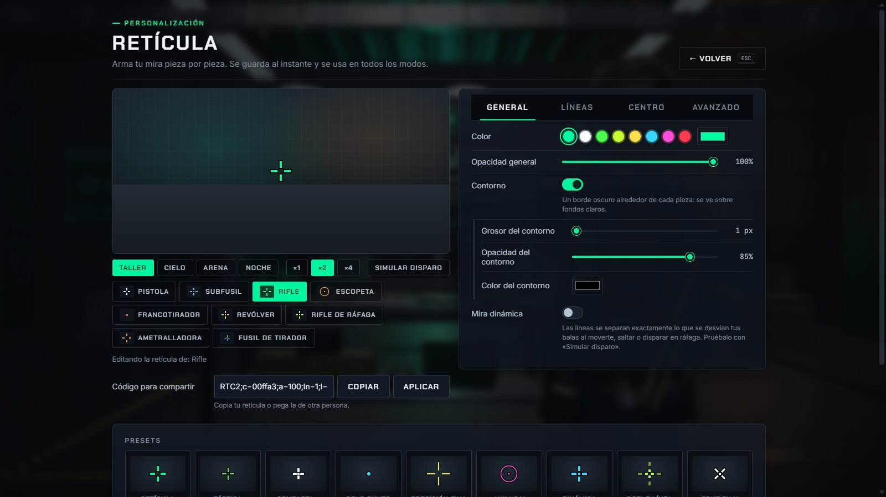 | 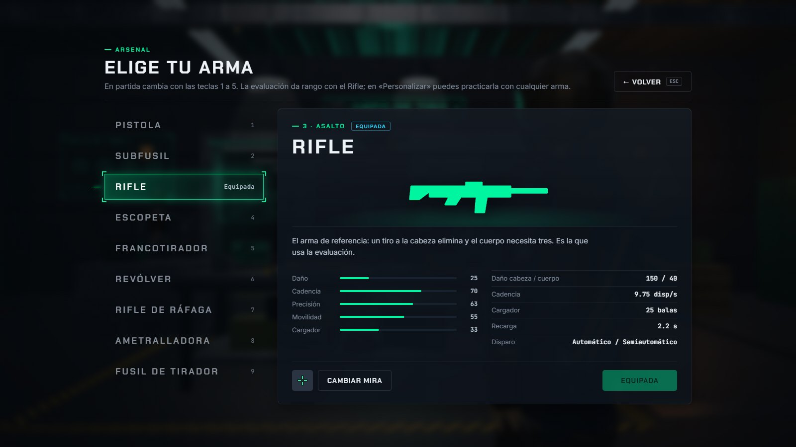 | 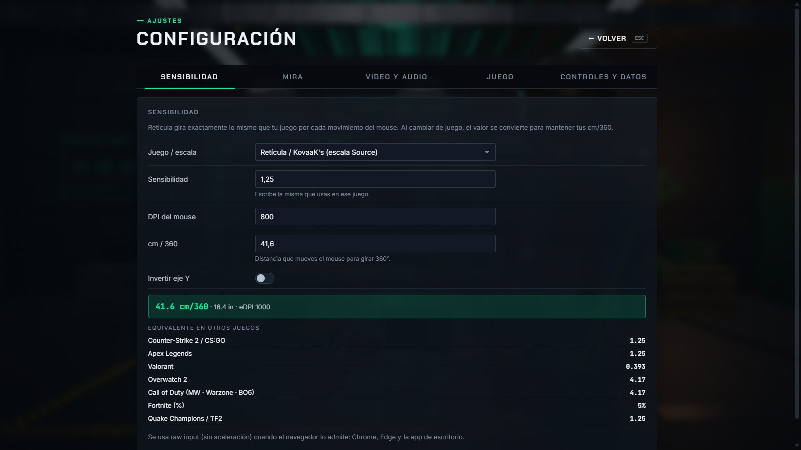 |

> Las capturas son del juego real (versión 1.5.0, calidad automática, 1600 × 900).

## Características

- **Evaluación con rango**: dos variantes de 5 fases (dianas y enemigos) con puntaje 0-100 y rangos
  Bronce, Plata, Oro, Diamante y Élite. También se puede **personalizar** (arma, duración, tamaño,
  velocidad, color de las dianas y fases a saltar) para practicar.
- **Campaña**: 3 mapas y 12 niveles con misiones, estrellas y dificultad que se adapta a tu rango.
- **Coordinación ojo-mano**: 4 ejercicios adaptativos (secuencia, color objetivo, periferia y doble
  tarea), solos o en circuito con índice de coordinación.
- **Modo infinito**: oleadas sin fin de soldados con IA que flanquea, con récords.
- **Modo zombi**: rondas al estilo de los modos de supervivencia clásicos, con barricadas, puertas que
  se compran, caja misteriosa, bebidas, generador, linterna con batería, jefe y 4 dificultades.
- **Defensa de la barra**: los zombis van por las botellas del bar y hay que protegerlas.
- **Historia «ECO»**: 8 capítulos con trama, escenas y radio.
- **9 armas** con modelos propios, brazos en primera persona, apuntar con miras, mira telescópica,
  cuchillo, 4 tipos de granada, casquillos con física y utilería que reacciona a los disparos.
- **Editor de retícula** pieza por pieza, con presets, mira dinámica y códigos para compartir.
- **Sensibilidad exacta**: conversión entre 8 juegos y cm/360, con raw input en Chrome, Edge y la app.
- **Progreso**: gráficas SVG accesibles, historial de todas las sesiones y exportar/importar datos.
- **Rendimiento**: calidad automática que mantiene 60 FPS, niveles de detalle para los zombis,
  geometría unida y sombreadores precompilados para evitar tirones.
- **Sonido** con Web Audio: disparos con eco, voces de zombi y música de terror generada en vivo.
- **Multiplataforma**: navegador, Windows, Mac y Android (con controles táctiles).

## Cómo ejecutarlo

Requisitos: **Node.js 22** (el que usa la CI) y un navegador con WebGL 2 y Pointer Lock (Chrome o Edge
recomendados: son los que dan raw input), mouse y teclado. Si falta algo, el juego lo avisa al abrir.

```bash
git clone https://github.com/Ju4nK1807/Reticula.git
cd Reticula
npm install
npm run dev       # abre http://localhost:5173
```

Otros comandos:

```bash
npm test          # pruebas automáticas (Vitest)
npm run build     # versión de producción en dist/
npm run preview   # sirve la versión de producción
```

Sin instalar nada: **https://ju4nk1807.github.io/Reticula/**

## Controles

| Tecla | Acción | Tecla | Acción |
|---|---|---|---|
| Mouse | Apuntar | Clic izquierdo | Disparar (mantener en automáticas) |
| `W A S D` | Moverse | Clic derecho | Apuntar con las miras |
| `Shift` | Correr / caminar | `R` | Recargar |
| `C` | Agacharse | `1`-`9` / rueda | Cambiar de arma |
| `Espacio` | Saltar | `B` | Automático / semiautomático |
| `V` | Cuchillo | `G` · `Q` | Granada · cambiar tipo |
| `E` | Usar, comprar, reparar | `F` | Linterna (modo zombi) |
| `[` `]` | Sensibilidad −3 % / +3 % | `Esc` | Pausa |

Todos los controles se pueden reasignar en *Configuración → Controles y datos*.

## Tecnologías y arquitectura

| Tecnología | Para qué |
|---|---|
| **Three.js** | Render 3D (WebGL 2), modelos glTF animados, postproceso (bloom, viñeta) |
| **Vite** | Servidor de desarrollo y compilación de producción |
| **JavaScript (módulos ES)** | Todo el juego, sin frameworks de interfaz: el HUD y los menús son DOM y CSS |
| **Web Audio API** | Sonidos, reverb y música generada en vivo |
| **Vitest** | Pruebas automáticas |
| **Electron** · **Capacitor** | Apps de Windows/Mac y Android |
| **GitHub Actions** | CI, publicación en GitHub Pages y compilación de las apps |

Ideas principales del diseño:

- **Registro de modos y mapas**: cada modo vive en su carpeta (`src/modes/<modo>/index.js`) y se
  registra solo con `registerMode({ id, title, create, locked })`; el menú y el juego los descubren con
  `import.meta.glob`. Agregar un modo no obliga a tocar `Game.js` ni el menú. Los mapas usan
  `registerWorld` de la misma forma.
- **Interfaz común de modo** (`src/modes/Mode.js`): `start`, `update`, `onShoot`, `onLock`,
  `hitMeshes`, `dispose`, etc. El motor (`Game`) solo llama a esa interfaz.
- **Física y balística propias**: hitscan con raycasts, hitboxes invisibles por parte del cuerpo
  (cabeza, torso, piernas) que siguen a los huesos animados, y cuerpos rígidos para la utilería.
- **IA**: los soldados hacen strafing, se asoman, se agachan, saltan y disparan con tiempo de reacción;
  los zombis navegan con un **campo de flujo** (Dijkstra sobre una cuadrícula de 1 m) compartido por
  toda la horda.
- **Guardado versionado** en `localStorage` con migraciones entre versiones, y exportar/importar a `.json`.

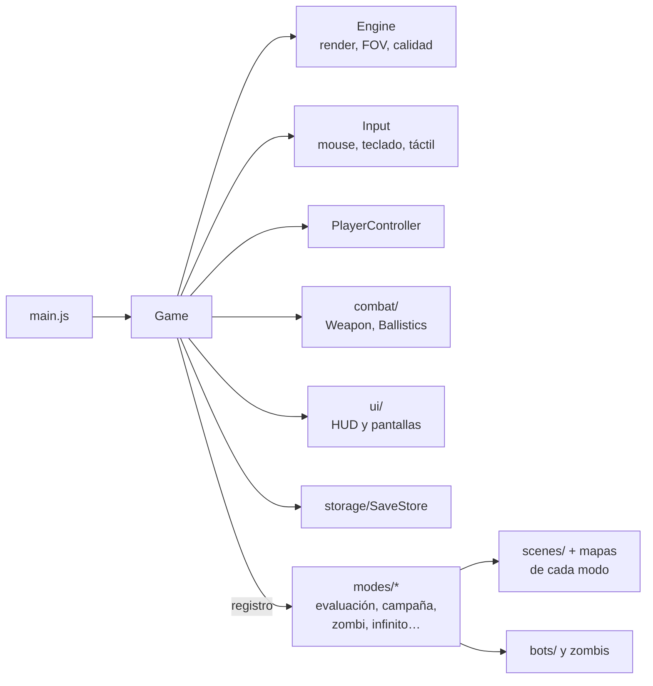

## Calidad: pruebas e integración continua

- **425 pruebas automáticas** en 45 archivos (`tests/`) con Vitest: puntajes y rangos, conversión de
  sensibilidad, guardado y migraciones, curvas de dificultad, balance de armas, registro de modos,
  navegación de los zombis y más.
- **Auditoría de mapas** con raycasts reales (`tests/campaignMaps.test.js`): verifica que cada enemigo
  de la campaña se pueda ver y alcanzar.
- **CI con GitHub Actions** (`.github/workflows/ci.yml`): cada PR y cada push a `main` ejecutan
  `npm ci`, `npm test` y `npm run build`. Solo se fusionan PRs en verde, siempre contra `main`.
- `deploy.yml` publica el juego en GitHub Pages y `release.yml` compila las apps al crear una versión.

## Apps: Windows, Mac y Android

Además de en el navegador, Retícula se descarga como app. Las descargas están en la pestaña
**Releases** del repositorio:

| Plataforma | Archivo | Cómo se juega |
|------------|---------|---------------|
| Windows | `Reticula-Setup-x.y.z.exe` (instalador) o `Reticula-Portable-x.y.z.exe` (sin instalar) | Mouse y teclado, con raw input y Pointer Lock igual que en Chrome. `F11`: pantalla completa |
| Mac | `Reticula-Mac-x.y.z-arm64.dmg` (Apple M1 o más nuevo) o `Reticula-Mac-x.y.z-x64.dmg` (Intel); también en `.zip` | Mouse y teclado, igual que en Windows |
| Android | `Reticula-x.y.z.apk` | **Controles táctiles**: joystick a la izquierda, arrastrar a la derecha para apuntar y botones de disparo, mira, recarga, salto, agacharse, arma y pausa. Siempre en horizontal y a pantalla completa |
| Navegador | https://ju4nk1807.github.io/Reticula/ | En el teléfono, "Agregar a la pantalla de inicio" la instala con su ícono |

Para instalar el APK en Android hay que permitir "Instalar apps de origen desconocido" al abrirlo.

En Mac, abre el `.dmg` y arrastra Retícula a Aplicaciones. Como la app no está firmada por Apple (eso
requiere una cuenta de Apple Developer), la primera vez hay que abrirla con **clic derecho → Abrir** y
confirmar. Si macOS dice que "está dañada", en la Terminal: `xattr -cr /Applications/Reticula.app`.
No hay versión para iPhone/iPad: instalar apps en iOS fuera de la App Store exige esa misma cuenta.

### Controles táctiles
Se activan solos en dispositivos sin mouse, o a mano en *Configuración → Juego → Controles táctiles*.
Ahí también están la sensibilidad táctil (independiente de la del mouse) y el eje Y invertido.

### Compilar las apps
```bash
npm run desktop          # abre la app de escritorio con la versión compilada
npm run desktop:build    # instalador y portable de Windows en release/
npm run desktop:mac      # DMG y ZIP de macOS en release/ (hay que compilarlo en una Mac; el CI lo hace)
npm run android:sync     # compila el juego y lo copia al proyecto Android (android/)
npm run android:build    # APK de depuración (necesita JDK 21 y el SDK de Android)
```

## Evaluación

Hay dos evaluaciones independientes, cada una con su propio rango y de unos 3 minutos. En ambas el
jugador se mueve (WASD, Shift, C, Espacio), las balas se ven (trazadoras, impactos y partículas) y
**cada fallo resta puntos**. Se juegan con el Rifle y sin recargar, para que los rangos sean comparables.

### Dianas (clásica) — campo de tiro

| Fase | Duración | Qué mide |
|------|----------|----------|
| Flicking | 30 s | precisión, objetivos/s, tiempo por objetivo, escapados |
| Tracking | 30 s, automático | % sobre la diana, % de balas acertadas |
| Reacción | 8 intentos | reacción promedio y mejor, disparos anticipados |
| Multi-objetivo | 30 s | objetivos/s y precisión con 3 dianas a la vez |
| Precisión | 30 s | precisión con dianas pequeñas (fallar resta más que acertar) |

Pesos: flicking 22 %, tracking 20 %, reacción 18 %, multi-objetivo 20 %, precisión 20 %.

### Enemigos — patio con coberturas

Bots humanoides de tamaño real (~1.77 m, cabeza de ~25 cm) con puertas, coberturas y balcón.

| Fase | Duración | Qué mide |
|------|----------|----------|
| Flicks | 30 s | precisión, % headshots, bajas/s, enemigos escapados |
| Tracking | 30 s, automático | % de tiempo sobre el enemigo, % de balas acertadas |
| Peeks y reacción | 10 apariciones | reacción desde que el enemigo es visible, daño recibido |
| Precisión a la cabeza | 30 s | % de tiros a la cabeza (el resto resta) |
| Combate en movimiento | 40 s, automático | bajas, precisión, headshots, vida restante |

Pesos: flicks 22 %, tracking 20 %, peeks 20 %, precisión 20 %, combate 18 %.
Rangos: Bronce 0+, Plata 30+, Oro 48+, Diamante 64+, Élite 80+ (`src/config/ranks.js`).

Cada variante guarda su propio rango. El **rango general** (el del menú, el que desbloquea modos) es el
mejor rango actual entre las dos variantes. Los tiempos de reacción se miden con el reloj real
(`performance.now()` y el instante del clic), así que no dependen de los FPS.

**Personalizar** (botón en la pantalla de cada evaluación, `src/modes/evaluation/evalConfig.js`): arma,
duración de las fases (10-120 s), cantidad, tamaño y velocidad de las dianas, color, intentos de
reacción, asomadas, cuánto disparan los enemigos y fases a saltar. Es para practicar: el rango oficial
solo sale de la evaluación sin cambios.

## Historia ECO

Campaña con historia propia (1979–1983). El capitán Andrés «Halcón» Vera despierta atado a una silla:
una voz le pregunta qué significan los números 7-3-9 que lee una estación de radio. Cada capítulo es un
recuerdo de cómo llegó ahí, desde el campo de tiro de Base Cóndor hasta la Torre Faro.

- 8 capítulos, cada uno en un mapa del juego: campo de tiro, patio, bodega, ciudad, barrio en ruinas
  (con las puertas abiertas), la Cúpula y la arena.
- Escenas entre misiones con texto que se escribe solo (clic o Espacio para avanzar, «Saltar escena»).
- Radio durante la misión según lo que pasa (bajas, encuentros nuevos) y una voz sintética para la
  transmisión de números.
- Tres tipos de capítulo: dianas, misión con soldados (vida que se recupera, granadas, armas del
  capítulo y recarga real) y la Cúpula (dispara los números en el orden de la transmisión).
- Sin límite de tiempo; si caes, se reintenta el capítulo. Cada capítulo terminado abre el siguiente
  (progreso en `records.story`).

## Campaña

Se desbloquea al hacer cualquier evaluación. Un mapa por tramo de rango, con 4 niveles cada uno
(12 en total). Se empieza en el mapa recomendado para tu rango; los inferiores siempre están abiertos y
completar un mapa abre el siguiente aunque tu rango no llegue.

| Mapa | Rangos | Escenario |
|------|--------|-----------|
| Bodega | Bronce · Plata | Almacén con estanterías, palés, montacargas, pasarela alta y portones |
| Ciudad | Oro · Diamante | Calle con coches cruzados, quioscos, balcones, callejones y plaza |
| Arena | Élite | Arena simétrica con torre central, plataformas laterales y pilares |

- **Niveles**: Reconocimiento (flicks y duelos), Asomadas (peeks desde coberturas y alturas), Fuego
  cruzado (varios a la vez y por los flancos) y Asalto final (todo mezclado, también por detrás).
- **Dificultad continua 0-11** (`botProfile` en `src/modes/campaign/campaignData.js`): los bots pasan del
  100 % al 72 % de tamaño, se mueven más rápido, cambian de dirección más seguido, amagan, se agachan y
  saltan más, y reaccionan antes (0.75 s → 0.31 s). Su daño por segundo va de ~3.6 a ~14.
- **Nota 0-100 y estrellas**: 45 % enemigos eliminados, 20 % precisión, 15 % cabeza, 12 % vida y 8 %
  rapidez; morir multiplica por 0.6 y deja el nivel sin estrellas. La 1ª estrella es la meta que
  desbloquea el siguiente nivel; la 2ª y la 3ª son para rejugar.
- **Sugerencia de bajar de mapa**: tras 3 intentos seguidos sin estrellas y con nota media 10 puntos o
  más bajo la meta del primer nivel del mapa, se recomienda practicar en el mapa inferior.
- **Auditoría de mapas** (`tests/campaignMaps.test.js`): con raycasts reales verifica que cada asomada se
  vea desde la zona del jugador, que cada escondite oculte, que los bots quepan, que las posiciones altas
  tengan piso y que haya terreno abierto suficiente. Si un mapa cambia y deja un enemigo imposible,
  la prueba falla y dice cuál.
- Progreso en `store.data.campaign` (`best`, `unlocked`, `recent`). `B` cambia el modo de disparo.

## Coordinación ojo-mano

Disponible desde el inicio (no requiere evaluación). Se juega en la **Cúpula**, una sala circular oscura y
neutra sin obstáculos, con una línea de horizonte a la altura de los ojos como referencia. Cada
ejercicio dura 45 s, da una puntuación de 0 a 100 y se puede jugar suelto o en **circuito completo** (los
cuatro seguidos, con un índice de coordinación y niveles Inicial → Élite). Munición ilimitada: aquí solo
cuenta la coordinación.

| Ejercicio | Qué hay que hacer | Se adapta | Mide |
|-----------|-------------------|-----------|------|
| Secuencia | Destruir dianas numeradas en orden | Serie limpia → +1 diana; 2 errores → −1 (4 a 9) | dianas/s, errores de orden, precisión |
| Color objetivo | Disparar solo a la figura indicada; la regla cambia cada 5-9 s | — | aciertos/s, figuras prohibidas, reacción al cambio |
| Periferia | Con la mira en el aro central, acertar objetivos en los bordes del FOV real | Escalera que converge al 75 % de aciertos | ventana final, aciertos por zona, reacción |
| Doble tarea | Seguir una esfera y disparar a dianas que aparecen | — | % sobre la esfera, reacción, vuelta a la esfera |

En **Color objetivo** cada color tiene su forma (azul esfera, amarillo cubo, magenta pirámide, verde
diamante), así que se puede jugar con daltonismo. Las fórmulas están en
`src/modes/coordination/coordScoring.js` y los récords en `records.coordination`.

## Modo infinito

Se desbloquea al hacer cualquier evaluación. Oleadas sin fin en el **Bastión**, un patio de 48 m con
8 puertas: los enemigos pueden llegar por cualquier lado.

- **Enemigos**: entran por las puertas, combaten en el sitio (strafing, se agachan, saltan, disparan)
  y avanzan hacia ti flanqueando, sin acercarse a menos de 6 m.
- **Avisos**: la lámpara de la puerta se pone roja y suena un aviso en estéreo 0.9 s antes de cada
  entrada. Las flechas alrededor de la mira señalan enemigos fuera de la vista; se ponen rojas si
  te están apuntando.
- **Dificultad** (`src/modes/endless/waves.js`):

| Oleada | Bots (simultáneos) | Tamaño | Reacción | Precisión | Daño |
|-------:|-------------------:|-------:|---------:|----------:|-----:|
| 1      | 4 (2)              | 100 %  | 0.80 s   | 20 %      | 7    |
| 5      | 12 (4)             | 90 %   | 0.66 s   | 28 %      | 9    |
| 10     | 22 (6)             | 78 %   | 0.49 s   | 38 %      | 12   |
| 15     | 32 (8)             | 65 %   | 0.31 s   | 48 %      | 14   |
| 16+    | 34 → 40 (8)        | 63 → 62 % | 0.28 s | 50 %      | 14   |

- **Supervivencia**: 100 de vida; +25 al superar una oleada; botiquines (+20) que caen con un 12 % de
  probabilidad (30 % si tienes menos de 40 de vida).
- **Puntos**: impactos y bajas × multiplicador de oleada (+10 % por oleada), +50 por baja a la cabeza,
  racha (bajas sin recibir daño) y bonificación por oleada superada (×2.5 si fue perfecta).
- **Controles extra**: `B` cambia entre disparo automático y semiautomático.
- **Récords** en `records.endless`: mejor oleada, puntaje, bajas y racha, y las últimas 20 partidas.

## Modo zombi

Oleadas de zombis en el **Barrio en ruinas**, al estilo de los modos de supervivencia clásicos: el
mapa se abre a medida que se gana y hay que devolverle la luz al barrio. No requiere evaluación.

- **Zombis realistas**: un modelo con anatomía real, texturas PBR y 13 animaciones (arrastrar los pies,
  caminata rápida, correr, gatear, arrastrarse sin piernas, dos zarpazos, cabezazo, golpe, grito y dos
  muertes). Cada zombi tiene su tono de piel, su ropa y su cantidad de sangre (sangre seca en la boca, el
  pecho y las manos), ojos que brillan en la oscuridad y un borde frío de luz de luna. Las balas dejan
  **heridas** donde entran (pegadas al cuerpo aunque se mueva), sueltan una neblina de sangre y manchan
  el suelo; los muertos dejan un charco. Una granada cerca puede **arrancarles las piernas**: siguen
  arrastrándose con los brazos. La caja de la cabeza sigue al hueso de la cabeza: los tiros a la cabeza
  se deciden por lo que se ve.
- **Noche con atmósfera**: farolas, fuego y fluorescentes con luz real (un puñado de luces que se
  reparten entre las fuentes más cercanas a la cámara), conos y charcos de luz, bruma baja pegada al
  suelo, fuego y humo animados, charcos que reflejan, ventanas con interior y cortinas, fachadas con
  cornisas, balcones, persianas de tiendas y bajantes, y en calidad alta un etalonaje de color con
  viñeta y grano. Texturas PBR nuevas (adoquines, calle rota, revoque, pared descascarada, metal y chapa
  oxidados, barro con hojas, piedra y azulejos sucios).
- **Niebla espesa** al estilo de los mapas de zombis clásicos: a unos 30 m ya casi no se ve, bruma baja que
  brilla bajo las farolas y bancos de niebla que flotan y se mueven con el viento alrededor del jugador
  (menos en calidad media y baja). **Más barreras y chatarra**: barreras de concreto, muros de sacos,
  autos quemados, pilas de neumáticos, palés, escombros y vallas de obra en todas las zonas.
- **Noche de terror**: el barrio está casi a oscuras y con una niebla negra densa (a unos 20 m no se ve
  nada). La cámara del modo es más cerrada (más aumento).
- **Linterna**: se prende y apaga con F (reasignable) o con el botón táctil, con un clic.
  - Es un foco que sigue la mirada y atraviesa la niebla: dentro de su círculo se ve mucho más lejos.
  - En calidad alta proyecta sombras. Apagada, solo se ven los ojos de los zombis.
  - Abajo a la izquierda, un ícono muestra si está prendida, apagada o sin batería, y cuánta carga queda.
  - **Batería**: dura 150 s prendida y se recarga apagada en 45 s. Con menos del 20 % la luz se debilita
    y titila. Vacía, se apaga sola y no vuelve a prender hasta recargar un poco. Los valores están en
    `BATTERY` (`src/modes/zombies/flashlight.js`).
- **Zombis payaso**: trajes de colores con lunares, rayas o rombos, cara pintada de blanco descascarado,
  rombos negros en los ojos, sonrisa roja, nariz, pelo de colores, sombrerito y gola (piezas pegadas a
  los huesos de la cabeza y el cuello). Mucha más sangre: salpicaduras en el traje, heridas más grandes,
  más neblina de sangre y más charcos.

- **El Circo y las barricadas**: se empieza encerrado en una carpa de circo abandonada (lona a
  rayas, pista con aserrín, banderines y focos de colores) con cuatro ventanas tapiadas. Los zombis
  salen de la tierra, arrancan los tablones uno a uno y recién entonces entran; mantener `E` junto a
  una ventana la repara (+10 puntos por tablón, hasta 500 por ronda). Todas las entradas del mapa
  tienen su barricada.
- **Secciones**: las puertas tapiadas se compran con puntos (`E`, desde cualquiera de sus lados).
  Cada una lleva un cartel con el precio. Al acercarte aparece «Presiona [E] para abrir ($precio)»,
  o «Dinero insuficiente» si no alcanza. Cuanto más lejos del Circo, más caras: la **Plaza** (500),
  la **Iglesia** (750; se llega desde el Circo), el **Mercado** y la **Estación** (1000), la
  **Subestación** (1250, al oeste), el **Hospital** (1500; por la Subestación o por un pasillo desde el
  Mercado) y la **Feria** (2000; por la Estación o por la Iglesia). Cada sección trae armas y bebidas
  nuevas, pero también sus propias entradas. La horda solo sale de las entradas de las secciones
  abiertas, de las más cercanas al jugador.
- **La Feria y el segundo piso**: un parque de diversiones abandonado con carrusel, rueda de la
  fortuna y puestos de juegos. La **Casa de la Risa** tiene una terraza a 3.6 m que se sube por dos
  escaleras, con una ametralladora en la pared. Los zombis también suben por las escaleras: desde abajo
  no te alcanzan, pero arriba solo hay dos salidas.
- **Electricidad**: el barrio empieza sin luz (farolas apagadas, una baliza roja girando). En la
  caseta de la Subestación está el **generador**: su palanca enciende las farolas, los focos, los
  fluorescentes del hospital, las máquinas de bebidas y la Forja. Sin luz solo funciona Segundo Aire.
- **Forja** (quirófano del Hospital, con electricidad): 5000 puntos forjan el arma que llevas — doble
  de daño, cargador y reserva ×1.5 y un brillo violeta y cian que recorre el arma.
- **Caja misteriosa** (el haz de luz azul): 950 puntos por un arma al azar. Empieza en la plaza y cada
  4 a 7 tiradas se muda a otro de seis lugares del mapa.
- **Armas**: se cargan hasta **3**. Con las manos llenas, comprar en la pared o sacar de la caja
  cambia el arma que tienes en la mano; el aviso de compra dice cuál. Se cambia de arma con `1`-`3`
  o con la rueda del mouse. El HUD muestra solo tus armas, con su ícono y su munición
  (cargador / reserva), y resalta la equipada.

  Precios en la pared: Revólver 900, Subfusil 1000, Escopeta 1500, Rifle 1600, Rifle de ráfaga 1800,
  Fusil de tirador 2000, Ametralladora 2500 y Francotirador 2750. El **Desintegrador** es el arma
  especial: rayos de energía que deshacen a casi cualquier zombi de un tiro. Cuesta 6000 en la terraza
  de la Feria y también sale, poco, de la caja.

  Los íconos son siluetas en SVG (`src/ui/weaponIcons.js`). Para usar imágenes, pon el archivo en
  `public/icons/weapons/` y su ruta en `ICON_IMAGES`.
- **Rondas**: la ronda 1 trae 6 caminantes lentos que mueren de 2 tiros de pistola (o 1 a la cabeza).
  En cada ronda aumentan la cantidad, la vida, la velocidad y el daño. Las fórmulas y todos los
  valores de balance están en `src/modes/zombies/roundConfig.js`:
  - cantidad = 4 + 1.6 × ronda (+ una curva suave)
  - vida = 55 × (1 + 0.2 × (ronda − 1)), y ×1.1 por ronda desde la 10
  - velocidad ×0.75 → ×1.35
  - daño ×0.6 → ×1.4

  En pantalla se ven la ronda y los zombis que faltan. Entre rondas hay 12 s de pausa con el cartel
  «Ronda X» y la armería abierta. Vivos a la vez: hasta 24, con un tope según la calidad gráfica
  (baja 14, media 20, alta 24). El cuchillo hace 150.
- **Vida y golpes**: la vida se regenera tras 5 s sin recibir golpes. Un tiro a la cabeza la hace
  volar, y algunos zombis siguen caminando sin ella hasta desangrarse.
- **Armas en la pared**: se empieza con la pistola (munición infinita). Las demás están colgadas en las
  paredes de cada sección (revólver, subfusil, rifle, escopeta, ráfaga, tirador, ametralladora,
  francotirador); con el arma ya comprada, el mismo puesto vende su munición a mitad de precio.
- **Bebidas** (máquinas del mapa, duran hasta caer): Coraza (vida 250), Doble Plomo (+50 % de daño,
  +25 % de cadencia), Mano Rápida (recarga al doble), Pies Ligeros (+15 % de velocidad), Segundo Aire
  (regenera antes y más rápido) y Último Aliento (si caes, te levantas una vez con toda la vida).
- **Armería** entre rondas (`E` o botón táctil): munición, botiquín y cuatro granadas —
  fragmentación, incendiaria (deja fuego), aturdidora (frena a la horda) y señuelo (atrae a los zombis
  y explota). `G` lanza y `Q` cambia de tipo.
- **Tipos**: caminante, corredor (rápido), reptante (bajo, difícil de acertar) y bruto (mucha vida y
  golpe fuerte; desde la oleada 5). Cada 6 oleadas, *noche de corredores*.
- **Potenciadores** que sueltan los zombis: munición máxima, doble puntos, muerte instantánea, bomba y
  botiquín.
- **IA**: los zombis van en línea recta si nada se interpone y, si no, siguen un campo de flujo
  compartido (Dijkstra sobre una cuadrícula de 1 m). El rumbo y la velocidad cambian de forma gradual
  y la animación sigue la velocidad real: se mueven fluidos, sin zigzag. Se separan entre sí y atacan
  con un gesto previo: retroceder a tiempo esquiva el golpe.
- La vida se regenera tras unos segundos sin recibir golpes. Flechas rojas junto a la mira avisan de
  zombis cerca y fuera de la vista.
- Igual que con los soldados, los modelos son solo la apariencia: los impactos los deciden hitboxes
  invisibles alineadas al cuerpo (el reptante, a ras del suelo).
- Créditos: zombi de medicinestorm (OpenGameArt, CC0); animaciones extra de bachosoftdesign (Poly Pizza,
  CC-BY 3.0); texturas de Poly Haven (CC0). Detalle en `public/models/characters/credits.json`.
- Las armas usan texturas reales de Poly Haven (CC0: metal pintado, polímero y nogal), teñidas con el
  acabado de cada una. El número de ronda va en la letra Creepster (Sideshow, OFL 1.1).
- **Dificultad** (se elige en la pantalla del modo y se recuerda; récords por dificultad):

  | Dificultad | Zombis |
  |---|---|
  | Fácil | más lentos y frágiles, pegan la mitad, menos y más espaciados; más regeneración |
  | Normal | la horda tal como fue pensada |
  | Difícil | más vida, velocidad y daño (×1.4), más zombis y menos respiro |
  | Locura | vida ×1.7, daño ×2, corredores desde la primera oleada, brutos desde la 3 y casi sin pausa |

  Más puntos cuanto más difícil.
- **Colisiones**: barreras y autos girados chocan con su forma real (antes, con la caja que los
  envolvía: había paredes invisibles), y después de moverse la horda se separa con una corrección
  firme: ningún zombi queda dentro de otro ni del jugador.

## Defensa de la barra

La misma plaza, otro objetivo: la fuente del centro es una **barra con 46 botellas de licor** (vino,
whisky, vodka, ron, ginebra y tequila) bajo una guirnalda de bombillas y un letrero «BAR».

- Los zombis van **primero por la barra** (con su propio campo de flujo hacia el contorno de la fuente):
  cada golpe rompe la botella más cercana. Si se rompe la última, se pierde la partida.
- Un zombi deja la barra y persigue al jugador si se acerca a menos de 3.2 m o si le dispara (unos
  segundos): sirve para sacarlos de la barra.
- Las botellas también se rompen con tus balas: hay que tener cuidado al disparar cerca de la barra.
- Armería, potenciadores, granadas y dificultades como en el modo zombi, más **«Reponer licor»** (8
  botellas). Récords propios.

## Mecánicas

- **Nueve armas** (teclas 1-9 o rueda del mouse): pistola, subfusil, rifle, escopeta, francotirador,
  revólver, rifle de ráfaga, ametralladora y fusil de tirador. Las automáticas (subfusil, rifle,
  ametralladora) disparan manteniendo el clic; la ráfaga, tres balas por clic; el resto, una por clic.
- **Munición infinita al entrenar**: en la evaluación, la coordinación y la campaña no hay que
  recargar. El modo zombi y el infinito sí administran la munición.
- **Brazos y manos** en primera persona sujetando cada arma; **cuchillo** (`V`) con su corte y
  **granadas** (`G`) que se ven en la mano antes de lanzarlas.
- **Apuntar con las miras** (clic derecho) en todas las armas: aumento propio de cada arma, menos
  dispersión y caminar más lento. El francotirador y el fusil de tirador usan mira telescópica.
- **Controles reasignables** en Configuración → Controles y datos (clic en una tecla y pulsar la
  nueva; si choca con otra acción, se intercambian). **Sombras** en Video: según el detalle,
  siempre o nunca.
- La evaluación no tiene ADS ni golpe: los rangos siguen siendo comparables.

## Física

- **Casquillos**: cada disparo expulsa la vaina del calibre del arma por la derecha (la escopeta al
  accionar la corredera, el francotirador al abrir el cerrojo); rebotan con su tintineo y quedan un rato en
  el piso. Se desactivan en *Configuración → Juego*.
- **Utilería con física** en el modo zombi y en el infinito: cajas, barriles, botes de basura, latas,
  conos y cajas de munición. El balazo los empuja desde el punto del impacto según el daño del arma (una
  lata sale volando, una caja apenas se mueve), las granadas los lanzan y el jugador, los bots y los
  zombis los empujan al pasar. Frenan las balas como cualquier cobertura y vuelven a su lugar en cada
  partida.
- Motor propio (`src/physics/`): cuerpos rígidos con puntos de contacto, rebote y rozamiento, cilindros
  que ruedan, choques entre objetos y reposo (lo que está quieto no gasta CPU). La evaluación y la campaña
  no tienen utilería, para que los rangos sigan siendo comparables.

## Rendimiento

- **Calidad automática** (por defecto): ajusta la resolución (hasta el 50 %) para mantener 60 FPS, también
  en la pantalla de título. Solo baja el detalle si sigue lento varias ventanas seguidas en la resolución
  mínima (bajarlo recompila los sombreadores: no se hace por un momento de carga). Parte de un nivel
  según la GPU.
- Modo zombi: tres niveles de detalle por zombi (24 mil, 7.7 mil y 2.4 mil triángulos sobre el mismo
  esqueleto; en GPUs integradas el costo de la horda era deformar vértices: con 24 zombis pasó de ~5 ms
  a menos de 1 ms). Los lejanos se animan a 20 Hz y solo los cercanos proyectan sombra. La sombra de la
  luna dibuja todo lo estático en una sola malla; los tablones de las barricadas son una malla
  instanciada; la navegación marca solo las celdas de cada colisionador (de 177 ms a 4 ms al abrir una
  puerta) y el campo de flujo tarda ~1 ms. Durante la pantalla del modo se dibuja todo el mapa una vez
  (en Windows, ANGLE termina de compilar cada sombreador en su primer dibujo real). La reserva de zombis
  se llena entre oleadas; la barra de la defensa es una malla instanciada por tipo de botella.
- Geometría estática unida por material y zona (pocas llamadas de dibujo), sombreadores precompilados
  y texturas subidas al cargar cada mapa, soldados y zombis reutilizados de una reserva: sin tirones al
  aparecer enemigos.
- Con un menú encima la escena no se dibuja (menos GPU y batería).
- El motor 3D (Three.js) va en un archivo aparte del código del juego: entre versiones queda en la
  caché del navegador y solo se descarga lo que cambió.
- En portátiles con dos tarjetas gráficas, la app de Windows pide la dedicada a Windows. En el
  navegador hay que asignarla en *Configuración de Windows → Sistema → Pantalla → Gráficos*.

## Progreso

La pantalla **Progreso** del menú reúne todo lo jugado:

- **Evaluaciones**: puntuación total de dianas y enemigos a lo largo del tiempo y una gráfica por fase.
- **Modos**: estrellas por mapa de campaña, oleada alcanzada en el modo infinito, índice del circuito y
  puntuación de cada ejercicio de coordinación.
- **Historial**: todas las sesiones de los cuatro modos, filtrables por modo.
- **Datos**: exportar todo (progreso y configuración) a un archivo `.json` e importarlo en otro navegador
  o computador. El progreso vive solo en el navegador (`localStorage`), así que conviene guardar una copia.

Las gráficas (`src/ui/charts.js`) son SVG sin librerías: paleta validada para daltonismo sobre la
superficie del juego, un solo eje, línea vertical y tooltip al pasar el puntero (también con teclado) y
una tabla de datos por gráfica.

## Mira y video

- **Retícula** (opción del menú principal, también desde el Arsenal y Configuración): editor de la mira
  pieza por pieza, con vista previa en vivo sobre cuatro fondos, zoom y *Simular disparo*:
  - líneas interiores (largo, grosor, separación, en forma de T) y líneas exteriores;
  - punto central (tamaño, opacidad, redondo o cuadrado) y anillo (radio, grosor, opacidad);
  - contorno (grosor, color, opacidad), color (muestras rápidas o a elección), opacidad general y
    rotación hasta 45° (cruz en X);
  - **mira dinámica**, que se abre exactamente lo que se desvían las balas al moverse, saltar o disparar
    en ráfaga;
  - una retícula por arma o la misma para todas, 12 presets, *Mis retículas* (guardar con nombre) y
    **códigos para compartir** (`RTC2;c=00ffa3;…`; los `RTC1` anteriores se siguen leyendo).
- **Calidad gráfica**: Alta, Media, Baja o Personalizada (resolución de render del 50 % al 100 %). Es lo
  que más FPS gana en equipos modestos.
- **Contador de FPS**: FPS promedio, ms por cuadro y *1 % low* (los cuadros más lentos, que se sienten
  como tirones), medidos con el reloj real.

## Publicación

`.github/workflows/deploy.yml` prueba, compila y publica el juego en **GitHub Pages** en cada push a `main`
(o a mano desde la pestaña *Actions*). Para activarlo, el dueño del repositorio debe ir una vez a
*Settings → Pages → Build and deployment → Source* y elegir **GitHub Actions**. Mientras no esté activado,
el flujo deja un aviso y no falla. Una vez activo, el juego queda en
`https://ju4nk1807.github.io/Reticula/`.

La versión compilada usa rutas relativas (`base: './'` en `vite.config.js`), así que también funciona en
cualquier subcarpeta o servidor estático.

## Sensibilidad

Valores de *yaw* por juego en `src/config/sensitivity.js`: Source/KovaaK's/CS2/Apex/Quake 0.022,
Valorant 0.07, Overwatch 2 y Call of Duty 0.0066, Fortnite (%) 0.005555. Se puede escribir la sensibilidad
de cualquiera de esos juegos o directamente los cm/360. En juego: `[` y `]` la ajustan un 3 %.

## Estructura del código

```
src/
  main.js                 Punto de entrada
  style.css
  core/                   Motor: Game (estados), Engine (render/FOV/overlay), Input (mouse y teclado),
                          PlayerController (mirada, movimiento, colisiones), Emitter
  combat/                 Ballistics (hitscan y línea de visión), Weapon, Viewmodel (arma en pantalla),
                          Melee (golpe), Grenades (granadas)
  effects/                Trazadoras, marcas de impacto, partículas, casquillos, chispas, cámara y
                          soldados del menú
  physics/                Cuerpos rígidos (RigidBody) y utilería con física de los mapas (Props)
  gfx/                    Superficies PBR, iluminación, calidad automática, cielo y texturas de canvas
  config/                 defaults, ranks, sensitivity (conversión entre 8 juegos y cm/360)
  storage/                SaveStore (localStorage versionado con migraciones), profile (rango general)
  audio/Sfx.js            Sonidos con Web Audio API: disparos grabados con cuerpo y eco, reverb, voces de zombi
  audio/zombieVoices.js   Perfiles de las voces de zombi (gruñido, chillido, rugido, estertor…)
  audio/HorrorMusic.js    Música de terror generada en vivo para el modo zombi (volumen propio en Ajustes)
  scenes/                 Mapas base (ShootingRange, TrainingYard), la Armería del menú y registry.js
  bots/                   Bots humanoides: hitboxes, strafing, peeks, agachadas, saltos y disparo
  modes/                  Mode.js (interfaz base), registry.js (registro), index.js (descubre los modos)
  modes/evaluation/       Evaluación: dos variantes de 5 fases + scoring → rango
  modes/story/            Historia «ECO»: 8 capítulos con trama, escenas, radio y la prueba de números
  modes/campaign/         Campaña: mapas Bodega/Ciudad/Arena, 12 niveles, misiones, progreso y estrellas
  modes/coordination/     Coordinación ojo-mano: sala Cúpula, 4 ejercicios adaptativos, circuito y récords
  modes/endless/          Modo infinito: mapa Bastión, IA de asalto, oleadas, HUD propio y récords
  modes/zombies/          Modo zombi: Barrio en ruinas, zombis realistas, atmósfera nocturna, campo de flujo y armería
  ui/                     HUD, mira, gráficas y pantallas (menú, editor de retícula, progreso, ajustes, pausa,
                          resultados, compatibilidad)
  stats/                  history.js: series e historial unificado para la pantalla de Progreso
  utils/                  math, format
tests/                    Pruebas de la lógica pura (guardado, rangos, sensibilidad, registros)
```

## Equipo

Proyecto del curso de 5.º semestre, hecho en equipo con ramas, pull requests revisados y CI:

| Integrante | GitHub |
|---|---|
| Camilo Rosero | [@KmiloRosero](https://github.com/KmiloRosero) |
| Ju4nK1807 | [@Ju4nK1807](https://github.com/Ju4nK1807) |
| Santiago Tulcan | [@tulcansantiago08-cell](https://github.com/tulcansantiago08-cell) |

## Créditos de recursos

- Zombi: medicinestorm (OpenGameArt, CC0). Animaciones extra: bachosoftdesign (Poly Pizza, CC-BY 3.0).
- Texturas PBR: Poly Haven (CC0).
- Fuentes: Inter, JetBrains Mono, Chakra Petch y Creepster (OFL 1.1), vía Fontsource.
- Detalle de modelos en `public/models/characters/credits.json`.
